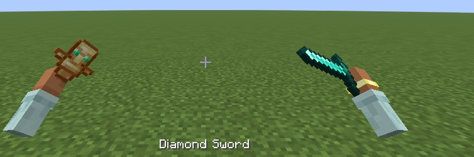
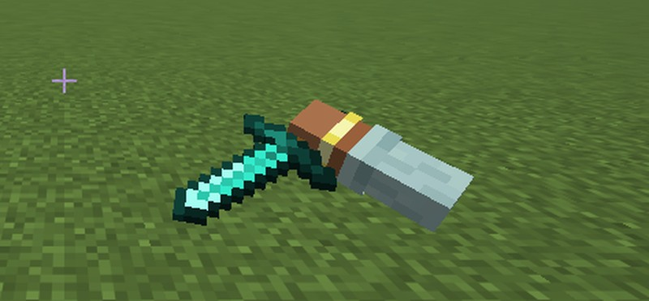

# Hand Animations: See Your Hand Holding Items in First Person

> See your hand holding your items in first person, with swing, use, draw and inspect animations for every item. Built for **Hypixel SkyBlock**, with per-item animations from resource packs. Client-side Fabric mod for Minecraft Java **26.2**.

Hand Animations is a **100% client-side Fabric mod**:

- **A visible hand holding your item** in first person, for both hands.
- **Animations for every item**: swings, use animations, a draw animation and an **inspect key** (Y).
- **Built for Hypixel SkyBlock**: picks each item's animation from its SkyBlock type.
- **Resource packs** can give any item its own grip, animations and model.

Nothing to install on the server, so it works on Hypixel and any other server.

## Features

### A visible hand in first person
- A small forearm at the lower right holds your item, and your off hand gets one too.
- Swords sit in the fist by the grip, torches stand upright and blocks keep their top facing up.

### Animations for every item
- **Swings by item type:** swords slash, backhand and stab in a combo, tools and drills chop, wands thrust.
- **Use animations:** food and potions go to your mouth, your other hand pulls the bowstring, crossbows charge and kick, shields block, fishing rods cast and reel, plus tridents, spears, brushes, placing blocks and pouring buckets.
- **Inspect key:** press **Y** to turn the held item over and look at it.
- **Draw, sprint, sway and idle fidgets.**

### Built for Hypixel SkyBlock
- Reads the type line in each item's lore (sword, drill, wand, fishing rod, bow, axe, hoe, shovel, gauntlet, deployable), including dungeon and recombobulated items.
- Drills shake while you mine, swords and wands flourish when you use an ability, rods cast.

### Custom animations with resource packs
- One JSON file per item in `assets/<namespace>/handanimations/items/`.
- Match items by Minecraft id, SkyBlock id or name, and set the grip, swing, use, draw and inspect animations and the model drawn in the hand.
- `/handanimations item` shows the held item's ids and which file matches it.
- Format: [PACKS.md](PACKS.md). Example: [HandAnimationsExamplePack.zip](HandAnimationsExamplePack.zip).

### Works with NoForcedPacks
- Follows [NoForcedPacks](https://modrinth.com/mod/noforcedpacks)' held item size and swing speed, with the hand still holding the item.

## Installation
1. Install [Fabric Loader](https://fabricmc.net/use/) and [Fabric API](https://modrinth.com/mod/fabric-api) for Minecraft 26.2.
2. Download Hand Animations from [Modrinth](https://modrinth.com/mod/handanimations) or [CurseForge](https://www.curseforge.com/minecraft/mc-mods/handanimations).
3. Drop the `.jar` into your `mods` folder and launch.

## Usage
- Hold anything. The hand is already there. Press **Y** to inspect.
- **Settings:** `/handanimations`, [Mod Menu](https://modrinth.com/mod/modmenu), or a key you bind in **Options → Controls → Key Binds** (unbound by default). Every animation group has its own switch, plus sliders for sway, inspect speed and the arm's position and rotation.
- **Commands:** `/handanimations inspect`, `/handanimations item`, `/handanimations reload`.

## Guides
- [How to see your hand holding items in first person](https://merenotnoonereal.github.io/handanimations/how-to-see-your-hand-holding-items/)
- [Hold My Items alternative for Minecraft 26.2](https://merenotnoonereal.github.io/handanimations/hold-my-items-alternative/)
- [Hypixel SkyBlock item animations](https://merenotnoonereal.github.io/handanimations/hypixel-skyblock-item-animations/)
- [Custom item animations with a resource pack](https://merenotnoonereal.github.io/handanimations/custom-item-animations-resource-pack/)

## FAQ
- **How do I see my hand holding items in first person?** Install Hand Animations. Vanilla hides your arm as soon as you hold an item; this mod draws the hand holding it.
- **Is it a Hold My Items alternative?** Yes, on Minecraft 26.2 (Hold My Items stops at 1.21.11), built around Hypixel SkyBlock items.
- **Does it work on Hypixel SkyBlock?** Yes, that's what it's built for.
- **Can I make my own item animations?** Yes, with a resource pack. See [PACKS.md](PACKS.md).
- **How do I change item size or swing speed?** Install NoForcedPacks; Hand Animations follows it.
- **Needed on the server?** No. It's fully client-side.
- **Is it bannable?** It only changes how your own hand looks and gives no gameplay advantage, but check your server's rules.

## Compatibility
| | |
|---|---|
| Loader | Fabric |
| Minecraft | 26.2 |
| Dependencies | Fabric API |
| Optional | Mod Menu, NoForcedPacks |
| Environment | Client only |
| Languages | 22 |

## Links
- **Modrinth:** https://modrinth.com/mod/handanimations
- **CurseForge:** https://www.curseforge.com/minecraft/mc-mods/handanimations
- **Website:** https://merenotnoonereal.github.io/handanimations/ (22 languages)
- **Also by me:** [NoForcedPacks](https://merenotnoonereal.github.io/noforcedpacks/)

## License
**All rights reserved.** See the `LICENSE` file. This mod is not open source. Please don't re-upload or redistribute it; link to the official Modrinth/CurseForge pages instead. The example resource pack may be used as a starting point for your own packs.
